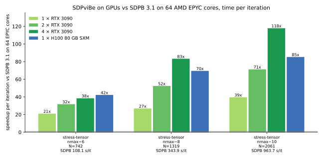

# SDPviBe

**A vibe-coded, drop-in GPU replacement for [SDPB](https://github.com/davidsd/sdpb)**, the semidefinite
program solver of the conformal bootstrap, written almost entirely by an AI coding assistant (Claude,
Anthropic) under the direction of Antoine Tilloy and validated against official SDPB. The same `sdpb` command line, the same input (SDPB's `pmp2sdp` output), the same
output files, checkpoints and terminate reasons, and the same algorithm iteration by iteration, running on
gamer GPUs. The [latest benchmark](docs/BENCHMARK_20261024.md) measures one, two and four RTX 3090s
and one H100, with unchanged precision and stopping rules.



<sub>GPU measurements refreshed October 24, 2026; mean time over iterations 2 onward.
All GPU columns use identical SDP files. The real case has a fresh SDPB 3.1 reference on 16 CPU ranks;
synthetic ratios use historical 64-thread CPU timings and are indicative.
[Data](docs/bench_3090.json) · [Protocol and validation](docs/BENCHMARK_20261024.md).</sub>

```bash
pmp2sdp --precision 768 -i pmp.json -o sdp                    # SDPB's own tool, unchanged
bin/sdpb -s sdp --precision 768 --findPrimalFeasible --writeSolution=x,y,z   # instead of `sdpb`
bin/sdpb -s sdp --precision 768 --gpus 4 ...                  # several GPUs (one process each)
```

Point any pipeline that calls `sdpb` (e.g. hyperion's `sdpb` wrapper, your own scripts) at `bin/sdpb`: no MPI, no other change.
SDPB's other tools (`pmp2sdp`, `spectrum`, `approx_objective`) work on its outputs as on SDPB's.

SDPB is the work of David Simmons-Duffin, Walter Landry, Vasiliy Dommes and collaborators (see
[Credits](#credits)); this project re-implements its interior-point algorithm in multiprecision arithmetic
on GPUs. It follows SDPB 3.1 step by step (same residues, Schur complement, Mehrotra predictor-corrector,
step lengths and termination criteria), so its `iterations.json` can be compared line by line with SDPB's.
It is *vibe coded*: written almost entirely by an AI coding assistant (Claude, Anthropic) under the
direction of Antoine Tilloy, and validated by comparing its iterations and outputs with official SDPB
(below) rather than by line-by-line human review. For results you publish, cross-check with SDPB.

## How it works

* **Numbers**: per-entry floating point, mantissas of L 32-bit limbs (two's complement) plus a 64-bit
  exponent, like SDPB's BigFloat (`sdpvibe/mpf.py`).
* **Matrix products are exact**: operands are split into residues modulo ~150 primes below 2^15, multiplied
  on **INT8 tensor cores**, and reconstructed by the Chinese remainder theorem (also on tensor cores), so
  every output entry is rounded once (`rns.py`, `limbops.py`).
* **Cholesky and triangular solves**: recursive, equilibrated fixed point, 32x32 base tiles on CUDA cores,
  batched over the SDP's blocks (`linalg.py`, `batched.py`, `basecase.py`).
* **Solver** (`solver.py`): blocks batched by matrix dimension with inert padding; the step-length
  eigenvalue uses a float64 copy.
* **Large problems** (`store.py`, `Layout` in `solver.py`): blocks are processed in chunks, and every
  per-chunk array is either GPU-resident or kept in pinned host memory and prefetched on side CUDA
  streams. The Gram matrix Q is accumulated in residue form across chunks with a single reconstruction per
  iteration (`mpf.GramAcc`). A planner picks the largest chunks that fit the GPU.
* **Several GPUs** (`dist.py`): one process per GPU; each owns a share of the chunks, per-chunk results are
  all-gathered and reduced identically on every rank, Q's partial sums are exchanged with NCCL.

## Validation against official SDPB 3.1

The optimized arithmetic passed the [correctness and compatibility checks](docs/PERFORMANCE_3090.md#correctness-and-compatibility)
and the [new 1/2/4-GPU and H100 comparisons](docs/BENCHMARK_20261024.md#numerical-validation).
The validation measurements below document the earlier input fixtures.

Iterates (mu, objectives, errors, step lengths) agree with SDPB to 1e-13 to 1e-15 relative, with the same
iteration counts and verdicts:
SDPB's example; single-correlator Ising nmax=6; mixed sigma-epsilon Ising nmax=6, 10, 14, 18 (first 20
iterations for the larger ones); stress-tensor system (T, sigma, epsilon) nmax=6, all 115 iterations.
The KPS nmax=6 island is reproduced. Streaming does not change results: unchunked runs are bitwise
identical to the original solver, streamed runs bitwise identical to resident ones with the same chunks,
and a fully streamed real SDP (mixed Ising nmax=10) agrees with the resident run to 1e-14 over all 131
iterations.

**Drop-in suite** (`tests/dropin_suite.py`: `pmp2sdp`, then `sdpb` and SDPviBe's `bin/sdpb` with identical
command lines on the same binary SDP, outputs compared file by file; one RTX 3090 vs SDPB on 64 cores):

| case | N | verdict (same for both) | iterations | worst / median digits per iteration | y digits | s/it SDPB | s/it SDPviBe |
|---|---|---|---|---|---|---|---|
| SDPB example | 1 | primal-dual optimal | 160 / 160 | 13.8 / 14.6 | 45.2 | 0.026 | 0.107 |
| Ising nmax=6, allowed | 20 | primal feasible | 28 / 28 | 14.6 / 15.2 | 15.1 | 0.47 | 0.133 |
| Ising nmax=6, excluded | 20 | dual feasible | 100 / 100 | 13.0 / 14.4 | 13.8 | 0.474 | 0.133 |
| Ising nmax=10, allowed | 54 | primal feasible | 51 / 51 | 14.5 / 14.9 | 14.8 | 0.837 | 0.156 |
| Ising nmax=10, excluded | 54 | dual feasible | 106 / 106 | 13.0 / 14.2 | 13.9 | 0.828 | 0.154 |
| mixed Ising nmax=6, in island | 104 | primal feasible | 61 / 61 | 13.7 / 14.8 | 14.0 | 2.82 | 0.466 |
| mixed Ising nmax=6, out | 104 | primal feasible | 62 / 62 | 13.3 / 14.7 | 13.6 | 3.13 | 0.464 |
| mixed Ising nmax=10 | 274 | primal feasible | 131 / 131 | 13.2 / 13.7 | 14.2 | 10.2 | 1.32 |

out.txt, x, z and c_minus_By agree to the same level. Features checked against SDPB: resume from a
checkpoint (bitwise identical to an uninterrupted run), text checkpoints SDPB -> SDPviBe and SDPviBe -> SDPB
(same iterations and final objective), zip input (bitwise identical), `--maxRuntime`, SIGTERM (exit 15,
checkpoint, resume), `--paramFile`. On tiny problems SDPB is faster per iteration (SDPviBe is bound by
~550 kernel launches per iteration, ~0.1 s); startup with warm kernel caches is ~4 s (the first run on a
machine compiles kernels, ~40 s).

## Performance

For the October 2026 single-3090 optimization study (profiling, same-GPU before/after
timings, numerical checks and reproduction commands), see [the detailed report](docs/PERFORMANCE_3090.md).

Earlier RTX 5090 measurements, per iteration against official SDPB on 56-64 cores (AMD EPYC):

| problem | SDPB (CPU) | SDPviBe (one RTX 5090) |
|---|---|---|
| mixed Ising nmax=10 | 9.45 s (56 cores) | 1.53 s |
| mixed Ising nmax=14 | 17.96 s (64 cores) | 2.04 s |
| mixed Ising nmax=18 (N=854, 1086 bits) | 36.68 s (64 cores) | 2.03 s (18x) |
| stress-tensor system nmax=6 (N=742, 5x5 blocks) | 65.5 s (64 cores) | 3.8 s (17x; 129.5 min vs 8.4 min end to end) |

**Refreshed October 24, 2026:** one, two and four RTX 3090s (24 GiB each) and one H100 80 GB SXM.
Seconds per iteration, mean over iterations 2 onward; six iterations for synthetic stress-tensor-shaped
SDPs at 832 bits, and a full solve for the real mixed-Ising case at 768 bits. All current GPU columns
use hash-identical input files. The real CPU reference is a fresh SDPB 3.1 run on 16 Xeon 8480+ ranks.
The synthetic CPU references are historical 64-thread EPYC timings: their original input hashes are
unavailable, so those CPU/GPU ratios are indicative.

| problem | N | SDP size | SDPB CPU reference | 1× 3090 | 2× 3090 | 4× 3090 | 1× H100 SXM |
|---|---:|---:|---:|---:|---:|---:|---:|
| mixed Ising nmax=10 (real, 768 bits) | 274 | 0.1 GiB | 10.15 (16 ranks) | 0.82 (12.4×) | 0.58 (17.4×) | 0.60 (16.8×) | 0.55 (18.6×) |
| stress-tensor nmax~6 | 742 | 1.8 GiB | 108 (64 threads, historical) | 5.13 (21.1×) | 3.40 (31.8×) | 2.81 (38.4×) | 2.56 (42.2×) |
| stress-tensor nmax~8 | 1319 | 5.9 GiB | 344 (64 threads, historical) | 12.80 (26.9×) | 6.57 (52.4×) | 4.13 (83.2×) | 4.95 (69.5×) |
| stress-tensor nmax~10 | 2061 | 14.7 GiB | 964 (64 threads, historical) | 24.40 (39.5×) | 13.52 (71.3×) | 8.17 (117.9×) | 11.30 (85.3×) |
| stress-tensor nmax~12 | 2968 | 30.1 GiB | not run | 49.80 | 27.10 | 15.09 | 18.62 |
| stress-tensor nmax~14 | 4040 | 54.3 GiB | not run | — | — | — | 29.75 |

The RTX host has an EPYC 7282, 256 GB RAM and PCIe 3 ×16 connections without NVLink; the H100 is a
700 W SXM model. The regenerated real input has 64 positivity blocks and differs from the earlier
131-iteration fixture. Current results, numerical agreement, same-host baseline comparisons and VRAM
measurements are documented in the [benchmark report](docs/BENCHMARK_20261024.md).

Four GPUs reduce the N=2061 iteration from 24.40 to 8.17 seconds. The small real case measured slightly
faster on two 3090s than four. Communication and work repeated on each GPU limit the available scaling. Larger cases also
benefit from keeping more block data resident across several 24 GiB cards. One H100 runs the largest
listed case, N=4040, at 29.75 seconds per iteration. These are throughput measurements, not claims of
faster convergence; precision and termination criteria are unchanged.

Earlier streaming measurements (synthetic SDPs with the stress-tensor system's block structure, scaled up; RTX PRO 6000 with
96 GB, PCIe 5; "32 GB" is a hard cap emulating an RTX 5090):

| nmax~ | N | data in host RAM | 96 GB card | 32 GB cap |
|---|---|---|---|---|
| 8  | 1319 | 18 GB  | 7.56 s/it (all resident) | 7.93 |
| 10 | 2061 | 36 GB  | 17.6 | 15.6 |
| 12 | 2968 | 62 GB  | 30.4 | 30.5 |
| 14 | 4040 | 102 GB | 52.0 | 61.9 |
| 16 | 5276 | 172 GB | 86.9 | 120.7 |

Details, history and design notes: [docs/DEVLOG.md](docs/DEVLOG.md).

## Install

Needs an NVIDIA GPU (developed on Ampere and Blackwell, also tested on Hopper), CUDA, PyTorch with Triton, and CuPy:

```bash
pip install torch numpy mpmath
pip install cupy-cuda12x        # or cupy-cuda13x, matching your CUDA
pip install -e .
```

## Usage: a drop-in `sdpb`

`bin/sdpb` (or `python -m sdpvibe`) takes **the same command line as SDPB 3.1's `sdpb`** and reads and writes
the same files, so scripts and pipelines that call `sdpb` can call it instead (e.g. hyperion's `sdpb.sh`
wrapper: `vast/st3d_setup.sh` with `SDPB_WRAPPER=sdpvibe`). No MPI is needed: one process drives one GPU,
or several with `--gpus` (below).

```bash
pmp2sdp --precision 768 --input pmp.json --output sdp          # official SDPB tool (CPU, MPI)
bin/sdpb -s sdp --precision 768 --findPrimalFeasible --findDualFeasible --writeSolution=x,y,z
```

* **input**: pmp2sdp output in binary (default) or JSON format, as a directory or an archive
  (`--zip`, tar, tar.gz); `normalization.json` for `z`.
* **options**: all of SDPB 3.1's (`--help`): `-s/--sdpDir`, `-o/--outDir` (default `<sdp>_out`),
  `-c/--checkpointDir` (default `<sdp>.ck`), `-i/--initialCheckpointDir`, `-p/--paramFile` (key=value),
  `--precision`, `--maxIterations`, `--maxRuntime`, `--checkpointInterval`, `--noFinalCheckpoint`,
  `--writeSolution`, `--verbosity`, the thresholds, initial matrix scales, centering parameters,
  `--stepLengthReduction`, `--minPrimalStep/--minDualStep`, `--maxComplementarity`, `--find*Feasible`,
  `--detect*FeasibleJump`. MPI-only options (`--procsPerNode`, `--procGranularity`, `--maxSharedMemory`,
  `--maxMemory`) are accepted and ignored.
* **outputs** (SDPB's formats and number formatting): `out.txt`, `iterations.json` (with the condition
  numbers), `c_minus_By/c_minus_By.json`, `y.txt`, `z.txt`, `x_<j>.txt`, `X_matrix_<k>.txt`, `Y_matrix_<k>.txt`.
  SDPB's `spectrum` and `approx_objective` read them as SDPB's own (approx_objective on SDPB's and on
  SDPviBe's solution of the same SDP: objective and its first and second derivatives agree to 13 digits,
  the agreement of the solutions).
* **checkpoints**: written every `--checkpointInterval` seconds and at the end; a checkpoint in the
  initial checkpoint directory is loaded at start, and resuming is bitwise identical to an uninterrupted
  run. Text checkpoints (`--writeSolution=x,y,X,Y` output directories) are exchangeable with SDPB in both
  directions. SDPB's own binary checkpoints (`checkpoint_<k>_<rank>`) are not readable.
* **SIGTERM** stops at the next iteration, writes a checkpoint and the solution, exits with code 15.
* **multi-GPU** (extension): `--gpus 2`, `--gpus 0,2` or `--gpus all` (default: `SDPVIBE_GPUS`, else one
  GPU). One process per GPU, like SDPB's MPI ranks: the blocks are distributed over the processes
  (balanced by work), each pass of an iteration runs on all GPUs at once, the per-block contributions
  are exchanged and reduced in block order on every rank, Q's partial sums are exchanged with NCCL and Q
  is factorised on every GPU. Results agree with a single-GPU run to working precision (usually
  bitwise in the printed digits) and are reproducible for a given GPU count; checkpoints do not depend
  on it. Every GPU holds Q, so this speeds up the block work, not the size limit; small problems gain
  little (they are bound by kernel launches).

GPU memory is planned from the card's total memory (results are reproducible run to run);
`SDPB_GPU_MEM_GB=<GB>` plans for (and enforces) a smaller budget. Other environment variables:
`SDPB_GPU_TIMING=1` (per-phase times and memory peaks), `SDPB_GPU_STREAM=all|none`, `SDPB_GPU_CHUNK_GB`,
`SDPB_GPU_PANELS`, `CUDA_VISIBLE_DEVICES` (which GPUs), `SDPVIBE_FAKE_GPUS=k` (testing: the multi-GPU
code path with k slots on one GPU).

SDPB's other executables (`pmp2sdp`, `spectrum`, `approx_objective`) are used as they are, on SDPviBe's
outputs; `outer_limits` (a different algorithm) is not reimplemented.

## Examples and tools

See [examples/README.md](examples/README.md): Ising single-correlator and mixed-correlator bounds and
scans with `scalar_blocks`, comparison with official SDPB, the stress-tensor system with the
`stress-tensors-3d` pipeline, and running everything on rented GPUs (vast.ai).

```
sdpvibe/   the solver package (python -m sdpvibe)
tests/     exactness and consistency tests, benchmarks (bench_stream.py: synthetic large SDPs)
tools/     PMP generators for Ising, SDPB/scalar_blocks images without docker, iteration comparison
vast/      scripts for rented GPU machines (setup, sync, self-destroying batch runs, stress-tensor pipeline)
cpu_baseline/  GMP reference for the multiprecision kernels
docs/      development log
```

**Conformal blocks on the GPU**: the GPU replacement for `blocks_3d` (batched multiprecision radial
recursion, numerators, pole shifting, write_output; a drop-in `blocks_3d` command writing the same JSON
files) lives in its own package, [BlocksviBe](https://github.com/AntoineTilloy/BlocksviBe), like blocks_3d
is separate from SDPB. It uses SDPviBe's multiprecision arithmetic (`sdpvibe.mpf`, `sdpvibe.rns`), not the
solver. Design notes and measurements: BlocksviBe's `docs/BLOCKS_PLAN.md`.

## Limitations

* Multi-GPU replicates Q on every GPU and factorises it on the first one (no distributed Cholesky yet).
* Q must fit in GPU memory: its factorisation is tiled when large (~1.6x the memory of Q instead of ~9x),
  but not out-of-core; on 24 GB cards this limits the stress-tensor system to nmax~18.

## Credits

This is a derivative of SDPB; please cite the SDPB papers if you use it:

* D. Simmons-Duffin, *A Semidefinite Program Solver for the Conformal Bootstrap*, JHEP 06 (2015) 174,
  [arXiv:1502.02033](https://arxiv.org/abs/1502.02033).
* W. Landry and D. Simmons-Duffin, *Scaling the semidefinite program solver SDPB*,
  [arXiv:1909.09745](https://arxiv.org/abs/1909.09745).
* SDPB repository and documentation (algorithm, `pmp2sdp`, file formats followed here):
  <https://github.com/davidsd/sdpb> (MIT license).

Also used or followed:

* `scalar_blocks` and `blocks_3d` (bootstrap collaboration) for conformal blocks:
  <https://gitlab.com/bootstrapcollaboration/scalar_blocks>, <https://gitlab.com/bootstrapcollaboration/blocks_3d>
  (R. Erramilli, L. Iliesiu, P. Kravchuk, W. Landry, D. Poland, D. Simmons-Duffin, *blocks_3d: Software for
  general 3d conformal blocks*, [arXiv:2011.01959](https://arxiv.org/abs/2011.01959)).
* The mixed sigma-epsilon Ising system: F. Kos, D. Poland, D. Simmons-Duffin, *Bootstrapping mixed
  correlators in the 3D Ising model*, [arXiv:1406.4858](https://arxiv.org/abs/1406.4858).
* The stress-tensor system and its pipeline: C.-H. Chang, V. Dommes, R. Erramilli, A. Homrich, P. Kravchuk,
  A. Liu, M. Mitchell, D. Poland, D. Simmons-Duffin, *Bootstrapping the 3d Ising stress tensor*;
  code at <https://gitlab.com/davidsd/stress-tensors-3d>.

## License

MIT (see [LICENSE](LICENSE)), like SDPB.
