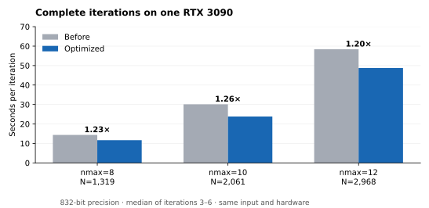

# RTX 3090 optimization study — 2026-10-24

This study compares the optimized solver with SDPviBe commit
`63683ab67d95d2416fb3115346375fc5bc9bc73b` on the same single RTX 3090.
It measures complete iterations, including host work and streaming. The target
was a twofold improvement without reducing precision or changing SDPB's algorithm.

## Complete-iteration measurements

The measured speedup is **1.20–1.26x**, below the twofold target. GPU memory use
is essentially unchanged. The optimization constraint is at most a few percent
more VRAM; the retained changes slightly reduce peak allocated memory in all
three large cases. Configurations with larger increases were rejected.

| Synthetic problem | Before | Optimized | Speedup | Peak allocated GPU memory, before / after |
|---|---:|---:|---:|---:|
| nmax=8, N=1319 | 14.37 s | 11.66 s | 1.23x | 11.82 / 11.81 GiB |
| nmax=10, N=2061 | 30.11 s | 23.84 s | 1.26x | 15.96 / 15.95 GiB |
| nmax=12, N=2968 | 58.39 s | 48.75 s | 1.20x | 16.31 / 16.30 GiB |



[Measurements and source hashes](performance_3090/timings.json) include all six
iteration times for each run. Across these three pairs, every differing
nontiming field differed by at most `1e-232` in absolute value; the other fields
were identical at their full printed precision.

The large cases are synthetic SDPs from `sdpvibe.synthetic.st3d_like`, with the
stress-tensor system's matrix-block structure. They measure six iterations, not
time to convergence on a physical bootstrap problem. Precision is 832 bits
(28 limbs), seed 0, automatic streaming/chunking, and the default four solve
panels. The median excludes the first two iterations for compilation and warmup.
The baseline and candidate run sequentially; order alternates across sizes.
Neither the profiler nor the synchronized phase timer is enabled for these runs.

Hardware/software: RTX 3090 24 GiB, 350 W limit, PCIe 4 x16, 128 GiB host RAM,
Intel Core i9-11900KF (8 cores / 16 threads), NVIDIA driver 580.82.09; PyTorch 2.7.1+cu128, Triton 3.3.1, CuPy 14.2.0.
`OMP_NUM_THREADS=1` and `OPENBLAS_NUM_THREADS=1` for both variants. No reference
solver or input-generation job runs concurrently with these timings.
Results record the source-file SHA-256 hashes, layout, iteration logs and memory.
Compilation and input construction are reported separately from iteration times.
A smaller real SDP (the regenerated mixed Ising nmax=10 input, N=274, 768 bits)
measured 0.490 → 0.441 s/iteration, a 1.11x speedup over the same six-iteration
protocol; its largest differing numerical field was only `4.3e-148` in absolute
value.
These measurements do not establish speedups on other GPUs or in multi-GPU runs.

## What the profile showed

The unmodified nmax=10 run spent approximately 24% in `L^-1 B`, 15% in residues,
12% in Schur Cholesky, 9% in Schur assembly, and 6% in Gram accumulation.
The remainder was spread over predictor/corrector work, step lengths, and the
final Cholesky. Those synchronized phase percentages are diagnostic; the table
above uses separate, uninstrumented runs.

One warmed iteration launched 527,955 CUDA kernels. The largest kernel totals were:

| Kernel family | Calls | GPU time in the profiled iteration |
|---|---:|---:|
| Residue conversion | 31,636 | 4.27 s |
| Batched RNS products | 16,027 | 3.16 s |
| CRT integer matrix products, larger shapes | 26,100 | 2.55 s |
| CRT carry propagation | 23,453 | 2.36 s |
| Tensor copies | 72,129 | 2.09 s |
| Multiprecision elementwise multiplication | 6,463 | 1.77 s |
| Cholesky tile kernels | 510 | 1.60 s |

GPU operation times overlap with transfers and are affected by profiling. They
must not be added to predict wall time. The raw trace is about 1.7 GiB; it is kept
outside Git. The bottlenecks are distributed: making one kernel twice as fast
does not make a complete iteration twice as fast.

## Changes retained

- Residue conversion processes 32 moduli and 64 entries per tile when possible,
  reusing input bytes while limiting register pressure. The final group of 16
  moduli keeps its previous layout.
- CRT reconstruction fuses its two INT8 products into one kernel and one output
  buffer. For at most 1,024 moduli, `|y| < 2^14` and `|digit| <= 128` guarantee
  that the combined digit sums fit in int32. Wider contexts retain the previous
  two-product implementation. The new kernel also avoids padding small output
  batches solely to satisfy cuBLAS constraints.
- GEMM tiles depend on rectangular shape and inner dimension. Medium products
  avoid the register spills of 128-by-128 tiles; sufficiently large products
  retain those larger tiles.
- Multiprecision multiplication scans product diagonals, accumulating low/high
  halves independently and propagating carry once per output limb. The entire
  product is still computed before the existing rounding step.
- Aligned batched addition fuses two independently rounded shifts and the sum.
  It preserves the original rounding order and supports strided inputs.
- Schur assembly skips block tiles above the diagonal, which were immediately
  overwritten by the lower triangle.
- Bit length uses an integer count-leading-zeros instruction. Besides saving
  work, this fixes `floor(log2(x))` occasionally returning one too little at
  exact powers of two (for example, the previous kernel reported 3 bits for 8).

Microbenchmarks justified the changes: the tested residue conversion improved
by roughly 1.3–1.5x, large CRT digit products by about 1.7x, medium GEMMs by up to
1.9x, large elementwise products by about 2x, and aligned addition by 1.3–1.9x.
Those are isolated operation measurements, not whole-solver speedups.

Rejected experiments included one solve panel instead of four (no speed gain,
higher GPU memory), broader carry-loop unrolling (no material gain), and using
small GEMM tiles everywhere (slower on the largest products).

[Further screening](performance_3090/additional_measurements.json) on the optimized
nmax=10 solver gave the following results
(four iterations each; median of iterations 3–4, so these are exploratory):

| Configuration | s/iteration | Peak allocated GPU memory |
|---|---:|---:|
| 16-by-16 Cholesky tiles | 29.46 | 15.91 GiB |
| 64-by-64 Cholesky tiles | 25.17 | 16.02 GiB |
| One solve panel | 24.12 | 18.77 GiB |
| Two solve panels | 24.75 | 17.42 GiB |
| Cache solved panels in host memory | 22.73 | 15.95 GiB |

The default 32-by-32 tiles and four panels remain appropriate. The caching
experiment retained Gram accumulation and bounded solves, but used stored P in
the predictor/corrector. It saved only about 5% against the optimized default
while increasing planned host storage from 27.7 to 41.7 GiB (measured process
peak 42.9 GiB). That tradeoff was left out of the production changes.

The bit-length correction can change the last limbs of a trajectory, so complete
runs are not promised to be bitwise identical to the previous release. No solver
precision, refinement count, feasibility threshold, or stopping rule is reduced.
On the 160-iteration example, baseline/candidate objective and central-path
quantities agreed beyond 187 digits; the smallest significant residual agreement
was 164 digits, and all step lengths and iteration counts were identical.

## Correctness and compatibility

85 assertion-based cases cover residue conversion, CRT reconstruction (including
the wide fallback), the int32 accumulation boundary, exact bit lengths, signed
multiplication and rounding, scalar broadcasting, aligned addition, extreme
exponent differences, and noncontiguous inputs. References use Python integers.

The existing GEMM, MPF, Gram-accumulator, base-case and linear-algebra scripts were
also run. GEMM/addition reported zero mismatches; high-precision Cholesky/solve
residuals were consistent with the limb precision and conditioning. BlocksviBe's
plan, recursion, derivative and output tests passed with the optimized arithmetic.

All eight cases in `tests/dropin_cases.json` were generated and solved with both
official SDPB 3.1.0 (eight MPI ranks) and the candidate, at 768-bit precision:

| Case | Iterations, both solvers | Verdict, both solvers | Worst significant iteration digits |
|---|---:|---|---:|
| Example | 160 | primal-dual optimal | 12.7 |
| Ising nmax=6, allowed | 28 | primal feasible | 14.5 |
| Ising nmax=6, excluded | 100 | dual feasible | 12.9 |
| Ising nmax=10, allowed | 50 | primal feasible | 14.4 |
| Ising nmax=10, excluded | 105 | dual feasible | 12.9 |
| Mixed Ising nmax=6, in | 82 | primal feasible | 13.6 |
| Mixed Ising nmax=6, out | 135 | dual feasible | 12.9 |
| Mixed Ising nmax=10 | 94 | primal feasible | 13.6 |

The comparison preserves the original raw relative-error metric and separately
reports differences below `1e-100` in absolute value. Relative error alone is
misleading for residuals near working-precision roundoff: the example ends with
a dual residual of about `1.7e-227` in SDPB versus `2.5e-212` in the candidate
(and `2.3e-212` in the unmodified package). These values are far below the solver's
`1e-30` feasibility tolerance. Excluding only those negligible absolute
differences, every case agrees to at least 12.7 digits throughout its trajectory.
[The saved validation data](performance_3090/sdpb_validation.json) retain both
metrics rather than silently dropping those fields.

The regenerated inputs use the generators' defaults (including lmax=30, order=60,
14 poles and 665-bit block generation). They are not the exact input files from
the older README timing table; in particular, mixed nmax=10 has 49 positivity
blocks. These new SDPB runs validate equivalence on identical input files; they
are not a replacement for the README's 64-core performance comparison.

Chunked and fully streamed mixed-Ising execution were bitwise identical for the
same chunks; changing the chunks agreed to 14.9 digits with the resident run.

[Checkpoint and CLI compatibility checks](performance_3090/validation_features.json)
also passed: binary resume and zip input were bitwise identical on the suite's
iteration fields; text checkpoints worked in both SDPB directions with matching
verdicts and iteration counts and at least 12 digits in the final y vector.
`--maxRuntime`, SIGTERM (exit 15, checkpoint and resume), and `--paramFile` passed.

## Reproduce

On a CUDA host, check out the baseline and optimized versions separately and copy
the two new profiling scripts into the baseline's `tools/` directory. Use the
same environment and GPU for both. Install the test runner with
`pip install -e ".[test]"` (CuPy must match the CUDA version, as in the main README):

```sh
export OMP_NUM_THREADS=1 OPENBLAS_NUM_THREADS=1
python tools/profile_large.py --nmax 10 --iterations 6 --output results/run.json
python tools/compare_profiles.py baseline/results/run.json candidate/results/run.json
python -m pytest -q tests/test_rns_kernels.py tests/test_mpf_mul.py tests/test_badd.py
```

Repeat for nmax=8 and 12. `compare_profiles.py` checks input options, software,
layout and every nontiming iteration field, requiring 100 digits of agreement
unless the absolute discrepancy is below `1e-100`. It reports exact identity
separately. Use `--phases` or `--profile` in an additional diagnostic run;
`--profile` records iteration three and may write a trace exceeding 1 GiB.
Use `--sdp PATH --precision 768` to benchmark a real preprocessed SDP.

For official-SDPB validation, use `tests/dropin_suite.py` with
`tests/dropin_cases.json`, the official `pmp2sdp`/`sdpb` executables and `bin/sdpb`.
The suite's raw relative metric needs the near-zero interpretation explained above.

## Remaining work toward 2x

The final synchronized nmax=10 phase run still spent approximately 25% in
`L^-1 B`, 16% in residues, 13% in Schur Cholesky, and 8% in Gram accumulation.
Schur assembly fell from about 9% to 5%. This explains why several near-twofold
kernel improvements produce a more modest complete-iteration gain.

The twofold whole-solver goal was not reached. The next candidates are reusing
factor residues across triangular solves and fusing CRT reconstruction with its
rounding/output stage, while keeping the memory plan bounded. Those would need
new implementation and validation; their prospective gains are not included in
this report. Simply storing P in host memory was tested and did not justify
adding its memory cost and extra solver mode for the small measured benefit.

This change retains full multiprecision products and the existing SDPB iteration,
refinement, feasibility and termination rules. The evidence covers one RTX 3090,
the specified warmed iteration ranges, and the eight complete real-SDP solves.
It does not claim a twofold gain, faster convergence, or performance improvements
on unmeasured hardware.
